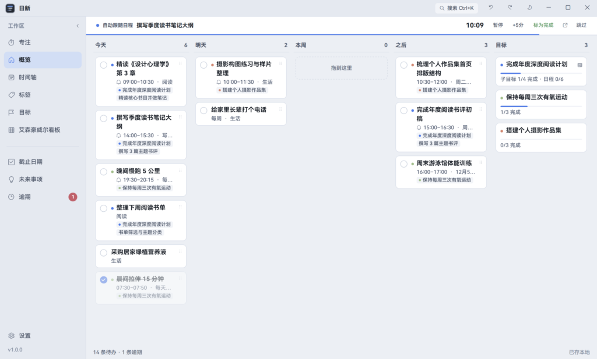
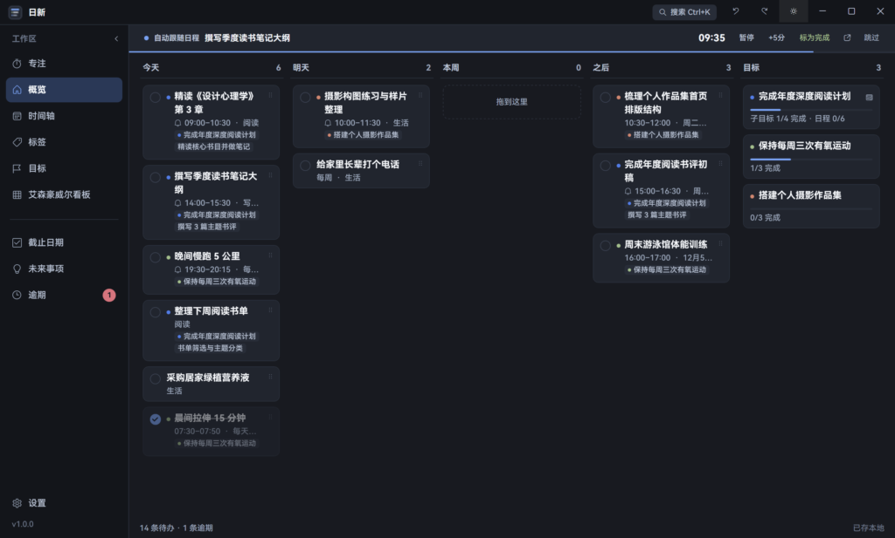
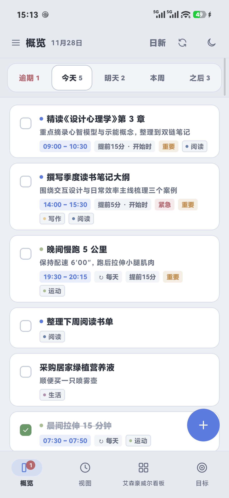
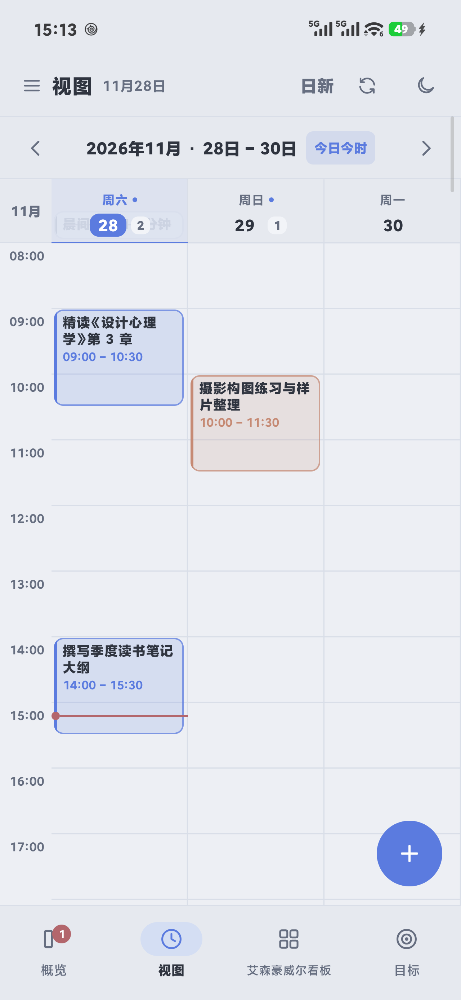
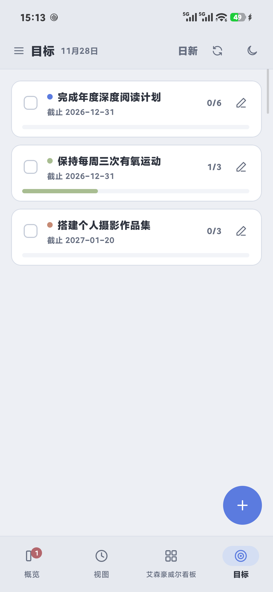
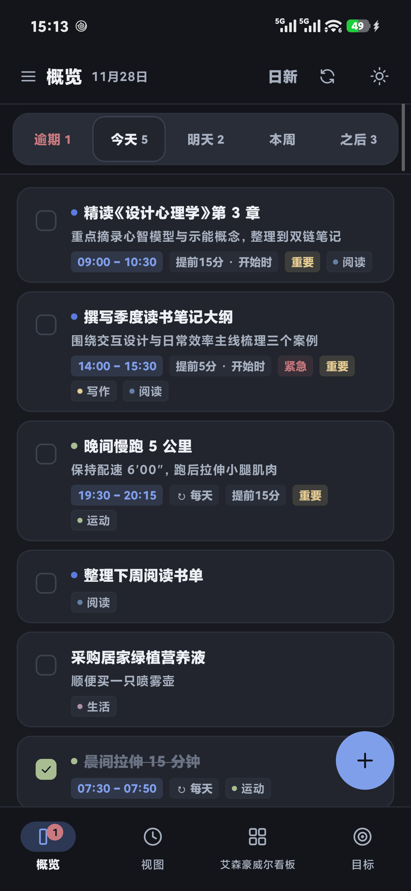
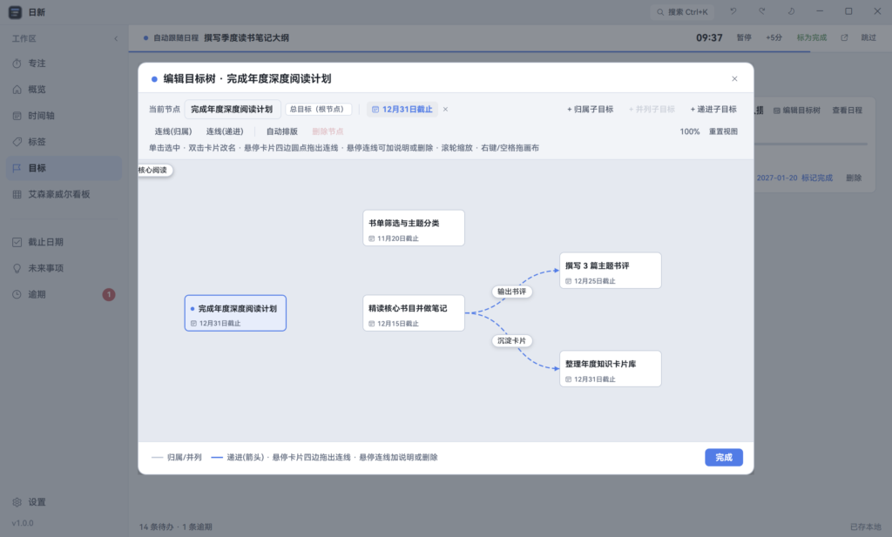
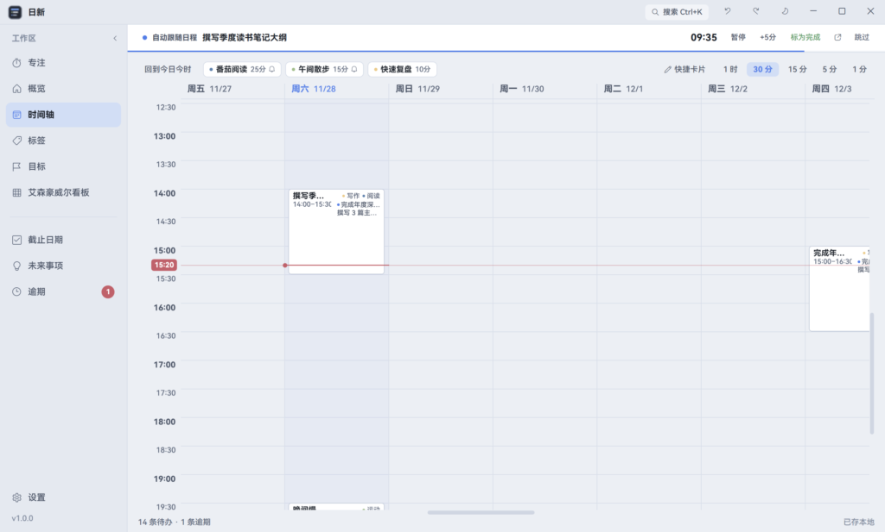
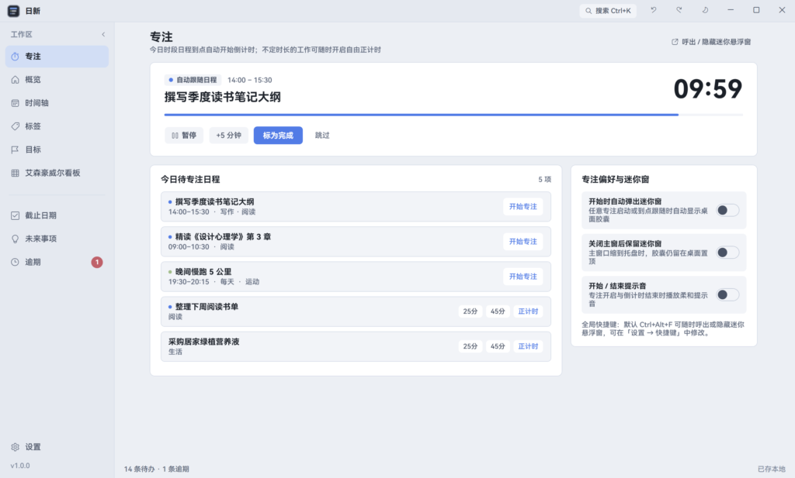
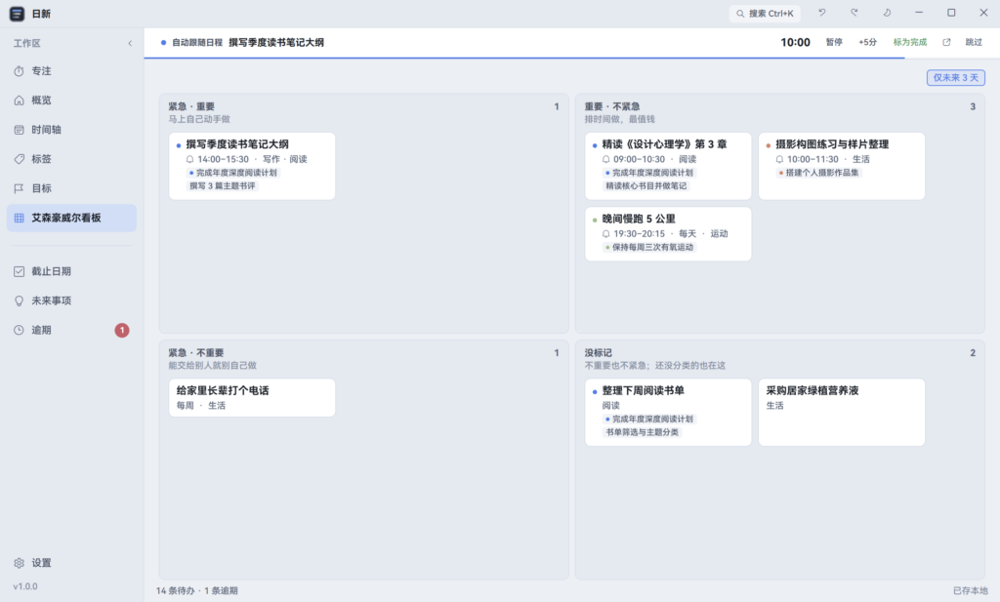

# 日新 / DayNew

> **不是日历软件，是任务软件。核心交互：看见就拖，不填表。**

[](https://github.com/Purestblues/DayNew/releases/tag/v1.0.0)
[](https://github.com/Purestblues/DayNew/releases/tag/v1.0.0)
[](docs/android-tech-selection.md)

**日新（DayNew）** 是一款本地优先、无服务端跨端同步的个人日程与任务管理工具，现已发布 **v1.0.0 正式版**（Windows 桌面端 + Android 移动端）。

传统待办软件常强迫你维护复杂的分类字段与日期选择器；日新反其道而行之：**只保留极简的底层实体，把「时间档位」做成由截止日期推导出的动态投影**。横拖一下就是改期，纵拖一下就是排序，拖到目标卡片上就是挂载——全流程所见即所得。

---

## 双端实机预览

### Windows 桌面端（浅色 Snow Storm / 深色 Polar Night）

| 浅色模式 · 概览工作区 | 深色模式 · 概览工作区 |
| :---: | :---: |
|  |  |

### Android 移动端（Kotlin + Jetpack Compose）

<table>
  <tr>
    <th align="center">概览看板（浅色）</th>
    <th align="center">时间轴视图</th>
    <th align="center">目标与进度</th>
    <th align="center">概览看板（深色）</th>
  </tr>
  <tr>
    <td align="center"></td>
    <td align="center"></td>
    <td align="center"></td>
    <td align="center"></td>
  </tr>
</table>

---

## 核心概念与功能

### 1. 动态档位推导：看见就拖，不填表

任务实体**不存储「今天 / 本周」这类状态字段**，所有档位均由任务的截止日期（`due`）与当天零点的关系实时计算：

- **六大档位**：`逾期`、`今天`、`明天`、`本周`（至本周日）、`之后`（下周一及以后），以及无截止日期的`未来事项`。
- **拖拽即操作**：
  - 在「概览」列间**横向拖拽**卡片，自动改写对应日期并开缝让位（iOS 桌面让位手感）；
  - 列内**纵向拖拽**直接调整手动执行顺序；
  - 将任务拖放到右侧**目标卡片**上直接建立归属关联；
  - 过期未完成任务自动落入「逾期」收件箱与红色角标，不会静默消失；
  - 概览列表自动按「带具体时段（按开始时间升序） → 不占时段（按手动排序） → 已完成沉底」排布。

---

### 2. 目标与目标树（Goal Tree）



长周期事情靠单纯的待办列表很难推进。日新内置可视化**目标树编辑器**：

- **结构化拆解**：一个总目标下可创建任意深度的子节点，支持**归属/并列（直线）**与**递进/前置（虚线箭头）**两种有向连线及自定义连线标签；
- **独立截止日期**：总目标与每个子节点均可单独设置可选截止日期，未完成条目自动汇总到「截止日期」视图；
- **画布交互与进度联动**：支持拖拽节点、四边端口拖出连线、滚轮缩放与一键自动排版；日程可通过多对多引用精准挂载到总目标或指定子目标上，进度条与统计实时重算。

---

### 3. 时间轴与单任务防重叠



时间轴不是另一套数据，而是同一批日程在「具体时刻」维度上的投影：

- **同一时间只干一件事**：新建或拖拽调整时段时，系统以当前缩放精度（桌面支持 `1 小时 / 30 分 / 15 分 / 5 分 / 1 分` 五档平滑缩放）自动向两侧寻找最近空档避让，避免物理时间冲突；
- **桌面端快捷创作**：在空白时间网格按住拖出一段即可创建带起止时间的日程；顶部「快捷卡片预设」支持拖入时间轴直接落地成对应时长的日程；
- **移动端顺滑操控**：Android 端时间轴支持**双轴全向自由平移与惯性飞滑**，长按日程块可跨天、跨时段精细拖拽改期，右上角一键「回到今日今时」。

---

### 4. 专注计时与自由专注（Windows）



专注状态机直接联动当天的日程流，尽量减少「开始计时」的启动阻力：

- **自动跟随日程**：空闲状态下，若当前时刻正处于今天某条带时段日程的区间内，顶部专注条会自动接管并显示剩余倒计时（可随时暂停、`+5 分钟`、直接完成或跳过）；
- **任务正 / 倒计时**：对任意今日待办或无时段任务一键开启 `25 分钟` / `45 分钟` 倒计时或正计时；
- **无绑定自由专注**：临时起意开始工作时直接开启自由正计时，**结束专注后自动拉起日程编辑弹窗并预填起始时间，保存即落盘为一条「已完成」日程**，同时自动追加进 `completions.ndjson` 历史日志；
- **迷你悬浮胶囊**：支持独立的桌面置顶迷你计时条（默认全局快捷键 `Ctrl+Alt+F` 呼出/隐藏），主窗口最小化到托盘后仍可实时掌控剩余时间。

---

### 5. 多维派生视图（单一数据源）



除「概览」「时间轴」「目标」「专注」外，左侧 Dock 还提供以下同步视图，**全部读写同一份底层数据**：

- **艾森豪威尔看板**：基于`紧急` / `重要`两个布尔标记实时分入四象限（「没标记」兜底收容未分类任务，桌面端可直接跨象限拖拽改属性）；
- **标签视图**：基于标签引用实时聚合分组（标签改名全局瞬间刷新）；
- **截止日期**：按天归并展示不占具体时段的待办与带截止日的目标节点；
- **未来事项**：专门收纳尚未定日期的灵感与长期想法，随时一键移入「今天 / 明天」；
- **逾期**：集中清理所有逾期未完成任务。

---

## 数据主权、多端同步与 AI 生态

### 无服务端 WebDAV + HLC 多设备同步

日新不依赖任何中心化专有服务器，只需任意标准 WebDAV 服务（如坚果云、Nextcloud、NAS 等）即可在 Windows 与 Android 间双向自动同步：

- **每设备独立快照**：每台设备上传独立的 gzip 压缩快照 `device-<deviceId>.json.gz`，配合 HTTP `ETag` 增量拉取，避免多端同时覆盖同一个远端文件；
- **混合逻辑时钟（HLC）字段级合并**：共用纯 Kotlin / C# 双向对齐的 `SyncMergeEngine`，实现精确到字段级别的冲突仲裁与墓碑删除传播；
- **真并发兜底**：遇到不可调和的并发文本编辑时自动保留 `[冲突]` 副本，绝不静默丢数据；
- **本机密钥保护**：WebDAV 凭证在 Windows 使用 **DPAPI** 加密存储，在 Android 使用 **Android Keystore (AES-GCM)** 加密存储，绝不明文落盘。

### 本地优先与跨端迁移

- **可读可备份的数据文件**：主数据以缩进 UTF-8 JSON 存放在本地（Windows：`%LOCALAPPDATA%\DayNew\data.json`），写入采用**原子替换（`.tmp` + `File.Replace`）**与上一版备份 `data.prev.json`；
- **分离式完成历史**：勾选记录以只追加方式写入 `completions.ndjson`，不随年限膨胀主配置文件；
- **`.daynew.zip` 跨端备份包**：Windows 与 Android 均支持一键导出/导入标准 `.daynew.zip` 归档（打包 `data.json` + `completions.ndjson`），支持「合并」与「覆盖」两种恢复策略，覆盖前自动生成本地安全备份。

### 本地 MCP Server（Windows AI 接入）

桌面端内置本地 [Model Context Protocol (MCP)](https://modelcontextprotocol.io/) 服务端（默认关闭，可在「设置 → AI / MCP」开启）：

- **双模式接入**：主进程内嵌 `127.0.0.1:37092/mcp`（Streamable HTTP + Bearer Token 鉴权），同时支持 `DayNew.exe --mcp` 极薄 STDIO JSON-RPC 桥接，可直接接入各类桌面 AI 客户端 / Agent；
- **14 个可用工具**：涵盖日程、目标（含节点树）、标签的检索与增删改查、完成状态切换及时间避让调度；
- **危险操作即时拦截**：所有 `delete_*` 删除工具均带有高危标注，调用时不仅由主进程 UI 线程串行执行，更会**强制弹出独立的置顶即时确认窗**（60 秒超时自动拒绝），防止 AI 误删个人数据。

### 双端原生体验打磨

| 平台 | 原生特性亮点 |
| :--- | :--- |
| **Windows 桌面端** | 系统托盘常驻、开机静默自启（`--tray`）、Windows Toast 日程节点提醒与贪睡延后、可自定义全局热键、业务级撤销 / 重做栈、`Ctrl+K` 全局搜索、Velopack 自动增量安装/更新 |
| **Android 移动端** | Jetpack Compose + Nord Frost 自适应双色主题记忆、5 档精细触感反馈（`DayNewHaptics`）、`setAlarmClock` 精确后台闹钟与系统提醒、Glance 桌面微件（Widget）、自适应图标与单色主题图标 |

---

## 下载与安装

前往 [GitHub Releases · v1.0.0 正式版](https://github.com/Purestblues/DayNew/releases/tag/v1.0.0) 获取对应平台安装包：

- **Windows（推荐安装版）**：下载 `DayNew.App-win-Setup.exe`，自动安装至 `%LOCALAPPDATA%\DayNew.App` 并生成桌面与开始菜单快捷方式；卸载不删除 `%LOCALAPPDATA%\DayNew\` 下的本地数据。
- **Windows（便携版）**：下载 `DayNew.App-win-Portable.zip`，解压即用。
- **Android**：下载 `DayNew-Android-v1.0.0.apk`（支持 Android 10 / API 29 及以上）。

---

## 从源码构建

### Windows 桌面端（.NET 10 SDK）

要求已安装 [.NET 10 SDK](https://dotnet.microsoft.com/)（`net10.0-windows10.0.19041.0`）：

```powershell
# 编译并运行测试
dotnet build DayNew.sln -c Debug
dotnet test DayNew.sln -c Release

# 运行主程序
.\src\DayNew.App\bin\Debug\net10.0-windows10.0.19041.0\DayNew.exe

# 打包 Velopack 安装包与便携版（输出至 releases\win-x64\）
.\scripts\pack.ps1
```

### Android 移动端（JDK 17 + Android SDK）

要求 JDK 17 与 Android SDK（`compileSdk 36`, `minSdk 29`, `targetSdk 35`）：

```powershell
cd android

# 运行核心同步模块与 App 单元测试
.\gradlew.bat :core-sync:test :app:testDebugUnitTest

# 构建 Release APK
.\gradlew.bat :app:assembleRelease
```

---

## 项目目录概览

```text
DayNew.sln
├── src/
│   ├── DayNew.App/             # Windows WPF 主程序（MVVM + Nord Frost 主题 + MCP + WebDAV）
│   └── DayNew.Tests/           # Windows 端同步、存储、撤销重做、MCP 单元测试
├── android/
│   ├── core-sync/              # 纯 Kotlin JVM 同步与业务推导引擎（HLC / 档位 / 提醒 / 重复规则）
│   └── app/                    # Android Jetpack Compose 客户端（闹钟、Glance 小组件、SAF 导入导出）
├── docs/
│   ├── images/                 # README 双端实机截图
│   └── android-tech-selection.md
├── scripts/
│   └── pack.ps1                # Windows Velopack 打包脚本
├── AGENTS.md                   # 双端工程约定、数据契约与开发规范
└── 方案.html                   # 产品初衷与多端同步架构设计稿
```

更多底层数据契约（`StoreDto`）、档位推导逻辑与跨端同步细节，可继续查阅 [AGENTS.md](AGENTS.md) 与 [方案.html](方案.html)。
